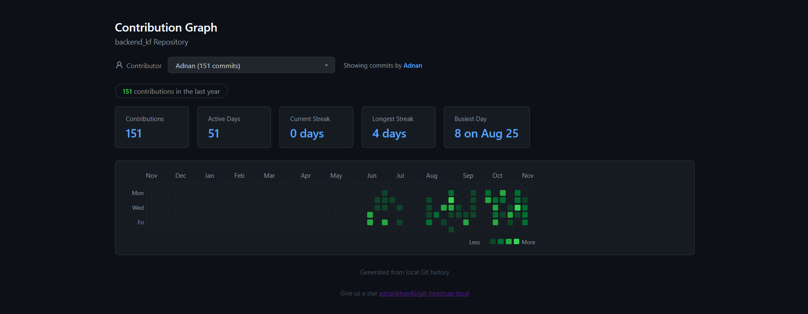

# git-contribution-graph

A script that generates a GitHub-style contribution heatmap for any local Git repository. Useful when your repo isn't on GitHub or you just want an offline view of your commit activity.

Reads `git log`, builds an HTML page with the green-square graph, and opens it in your browser. No dependencies, no server, just a single HTML file.



## What it does

- Pulls all commit dates and authors from your local git history
- Generates a self-contained `contribution-graph.html`
- Shows the last 52 weeks of activity (same layout as GitHub)
- Dropdown to filter by contributor
- Hover tooltips with date and commit count
- Stats: total commits, active days, current streak, longest streak, busiest day

## Usage

### Windows

Drop `generate-graph.ps1` and `generate-graph.bat` into your project root.

Double-click `generate-graph.bat`, or run from terminal:

```
powershell -ExecutionPolicy Bypass -File generate-graph.ps1
```

### Mac / Linux

Drop `generate-graph.sh` into your project root.

```
bash generate-graph.sh
```

Both scripts output `contribution-graph.html` in the same directory. Open it in any browser.

## How it works

The script runs `git log --format="%ad|%an" --date=short --all` to get every commit date and author, then embeds that data into a static HTML file. The graph rendering is pure JS -- no build step, no network requests.

The contributor dropdown defaults to your `git config user.name` if it matches an author in the log.

## Files

| File | Platform | Notes |
|------|----------|-------|
| `generate-graph.sh` | Mac, Linux, Git Bash | Bash script |
| `generate-graph.ps1` | Windows | PowerShell script |
| `generate-graph.bat` | Windows | Launches the PS1 script (double-clickable) |

## License

MIT
